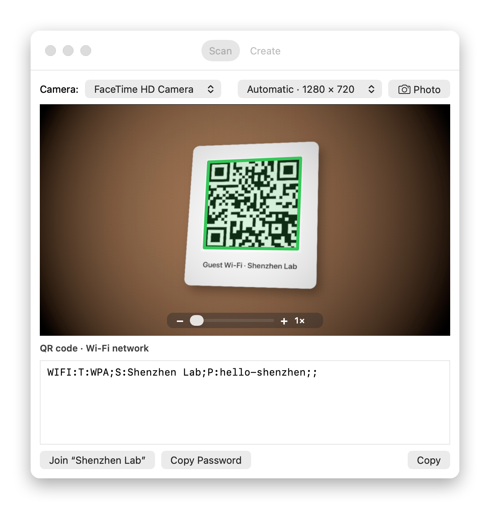
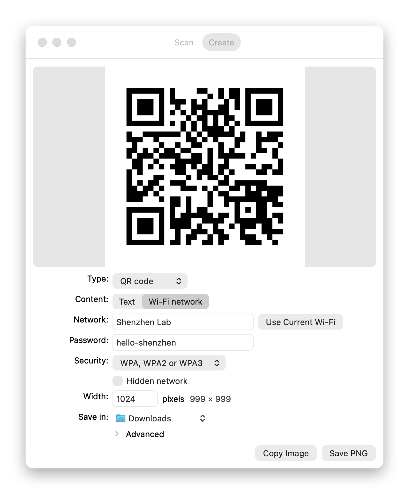

# ShenzhenQR

A tiny Mac app that reads QR codes and barcodes from any camera (the built-in one, a USB webcam, a virtual camera or an iPhone) and makes them.

<a href="https://github.com/casimir-engineering/shenzhen-qr/releases/latest/download/ShenzhenQR.dmg"></a>

Apple Silicon · macOS 14+ · Signed and notarized

## Scan



- **Any camera.** Pick it from the menu at the top: the built-in one, a USB webcam, a virtual camera or an iPhone. ShenzhenQR remembers your choice and notices cameras being plugged in or removed. The menu beside it lists the picture sizes that camera has, and the window fits the camera's picture.
- **Every common code.** QR, Micro QR, Aztec, Data Matrix, PDF417, EAN and UPC, Code 128, 39 and 93, ITF, Codabar and GS1 DataBar. A green outline marks each one; with several in view, click one to use it.
- **The text, ready to use.** What the code holds appears in a field you can select and edit. **Copy** puts it on the clipboard.
- **The right next step.** Depending on the code: **Join** a Wi-Fi network (or copy its password), **Open in Browser**, **Add to Contacts**, **Add to Calendar**, **Write Email**, **Call**, **Send Message** or **Show in Maps**. Buttons follow your edits.
- **Zoom for small codes.** Double-click the picture to zoom 2.5× into the middle, and again to zoom out, or use the zoom bar at the bottom of the picture. Only the middle is read then, closer up, so smaller codes are found.
- **Photo and text.** **Photo** freezes the picture and reads the text in it, Chinese included: select text right on the photo, as in Preview, or edit all of it in the field below. Codes on the photo are outlined too; click one to put it in the field.
- **Blurred barcodes.** On a photo or a picture, when a barcode's bars are too blurred to read, its number is read from the digits printed under it, and kept only if its check digit is right (dashed outline). A camera can't focus up close: hold the code farther away and zoom in instead.

## Create



- **Codes as PNG.** A QR code, Data Matrix, Aztec code, PDF417, Code 128, EAN-13, UPC-A or EAN-8, crisp at the width you ask for, saved in Downloads unless you choose another folder. **Copy Image** puts it on the clipboard.
- **Wi-Fi codes.** For a QR code, **Wi-Fi network** makes a code that phones scan to join a network. Type its name and password, or click **Use Current Wi-Fi** to take this Mac's: macOS asks once for Location, as it counts Wi-Fi names as location, then for your Mac's password before sharing the Wi-Fi password.
- **Advanced**, closed until you open it: error correction, quiet zone, Data Matrix shape, bar height, the digits under EAN and UPC barcodes, colors, a transparent background and the file name, each at the standard value until you change it.

## Settings and updates

- **Settings** (⌘,): the camera resolution, and how many processor cores read frames at the same time (4 unless you change it).
- **Updates.** ShenzhenQR checks for a new version once a day and asks before installing it. **Check for Updates…** in the app menu checks now.

## Install

Download `ShenzhenQR.dmg` with the button above, open it and drag ShenzhenQR onto Applications. When you first open ShenzhenQR from Applications, it ejects the disk image for you. Opened straight from the disk image, it offers to move itself to Applications.

Requires macOS 14 or later on Apple Silicon. Nothing you scan leaves your Mac.

## Command line

The app is also a command-line tool. To call it `shenzhenqr`:

```bash
sudo ln -sf /Applications/ShenzhenQR.app/Contents/MacOS/ShenzhenQR /usr/local/bin/shenzhenqr
```

```text
$ shenzhenqr scan desk.jpg
desk.jpg: QR code · Wi-Fi network · at x 513, y 167, 301 × 283 px of 1280 × 720
  WIFI:T:WPA;S:Shenzhen Lab;P:hello-shenzhen;;
  → Join “Shenzhen Lab” · Copy Password
```

- `shenzhenqr scan [options] <picture>...` reads every code in pictures (`-` reads standard input).
- `shenzhenqr camera [options]` prints each new code a camera sees, until Ctrl-C; `--once` stops at the first.
- `shenzhenqr ocr [options] <picture>...` reads the text in pictures, line by line; `--json` adds each line's position.
- `shenzhenqr photo [options] <file.png|file.jpg>` takes a photo with a camera; `--ocr` also prints its text.
- `shenzhenqr cameras`, `shenzhenqr types` list the cameras with the picture sizes each one has, and the code types.
- `shenzhenqr parse <text>` says what a code's text is and what can be done with it; `shenzhenqr run <text> join` does it.
- `shenzhenqr make [options] <text>` makes a code as a PNG in Downloads: `--type qr` (default), `datamatrix`, `aztec`,
  `pdf417`, `code128`, `ean13`, `upca` or `ean8`; `--out` another file or folder (`-` writes the PNG to standard
  output); `--size`, `--margin`, `--correction`, `--color`, `--background` (`transparent` too), `--shape`, `--height`,
  `--no-digits`. It prints where it saved the file.
- `shenzhenqr wifi --ssid <name> --password <p>` makes a Wi-Fi code (`--current` takes this Mac's network; `--print`
  gives its text only; `--security wpa|wep|none`, `--hidden`, and make's options).
- `shenzhenqr update` installs the newest version; `shenzhenqr update --check` only says whether there is one.
- `shenzhenqr settings [<name> <value>]` shows or changes the app's settings: `resolution` (`auto` or a size such as
  `1920x1080`), `cores`, `zoom`, `camera`.

`--json` gives one JSON object per code with its type, text, kind, actions and position: `box` (x, y, width,
height) and `corners`, in pixels from the picture's top-left corner. `--text` gives only the text, `--first` only the
biggest code, `--types qr,ean13` only those types, `--cores <n>` how many pictures or frames are read at once.
`--region x,y,width,height` reads only that part of the picture, in pixels from its top-left corner
(`--region 1900,1100,300,250`) or in fractions (`--region 0.25,0.25,0.5,0.5`); `--zoom 2.5` reads only the middle, as
the window's zoom does. A small code is found that way when the whole picture misses it. Positions stay in the whole
picture.
`shenzhenqr help` has the rest. Exit status: 0 a code was read, 1 none was, 2 the command was wrong, 3 the camera
can't be used. The camera needs your terminal app allowed in System Settings › Privacy & Security › Camera.

## Build

One Swift file, no dependencies:

```bash
./build.sh            # build/ShenzhenQR.app, signed for this Mac only
./build.sh --release  # Developer ID signature, notarized app and disk image
```

`make-icon.swift` draws the icon. `ShenzhenQR --screenshot <out.png> <picture>` draws the Scan screenshot above, from a picture standing in for the camera; `ShenzhenQR --screenshot <out.png> create qr "wifi=<network>"` draws the Create one.
